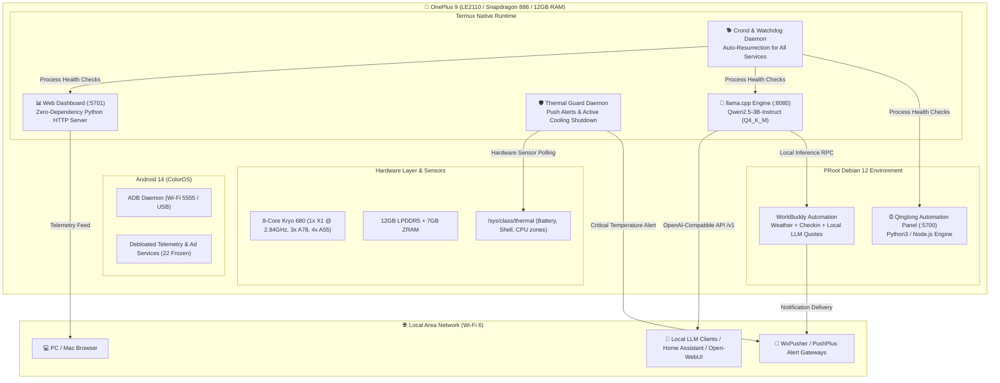

# 🚀 OnePlus 9 Edge Micro-Server Suite

> Transform an idle flagship OnePlus 9 (Snapdragon 888, 12GB LPDDR5, UFS 3.1) into an ultra-low-power (~2.5W - 5W), 24/7 edge computing node, local LLM inference server, automation orchestrator, and real-time telemetry dashboard — **100% Rootless & Non-Destructive**.

[](https://opensource.org/licenses/MIT)
[](https://www.qualcomm.com/products/mobile-processors/snapdragon-888-5g-mobile-platform)
[](https://termux.dev/)
[-orange.svg)](https://github.com/ggerganov/llama.cpp)
[-purple.svg)](#-real-time-performance-dashboard)

---

## 📑 Table of Contents
- [Architecture Overview](#-architecture-overview)
- [Key Features](#-key-features)
- [Hardware & Benchmark Performance](#-hardware--benchmark-performance)
- [Port & Service Directory](#-port--service-directory)
- [Project Structure](#-project-structure)
- [Quick Start Guide](#-quick-start-guide)
  - [1. Non-Destructive Debloating (ADB)](#1-non-destructive-debloating-adb)
  - [2. Termux & PRoot Debian Setup](#2-termux--proot-debian-setup)
  - [3. Compiling llama.cpp (ARMv8.2-A + FP16)](#3-compiling-llamacpp-armv82-a--fp16)
  - [4. Deploying the Real-Time Performance Dashboard](#4-deploying-the-real-time-performance-dashboard)
  - [5. Thermal Guard Daemon & Automated Watchdog](#5-thermal-guard-daemon--automated-watchdog)
- [Telemetry Dashboard Preview](#-telemetry-dashboard-preview)
- [Security & Best Practices](#-security--best-practices)
- [License](#-license)

---

## 🏛 Architecture Overview



---

## ✨ Key Features

1. **Local Edge LLM Inference Server (OpenAI-Compatible)**
   - Powered by `llama.cpp` compiled natively for ARMv8.2-A with NEON FP16 acceleration.
   - Runs `Qwen2.5-3B-Instruct (Q4_K_M)` or `DeepSeek-R1-Distill-Qwen-1.5B` entirely on-device without internet latency or token costs.
   - Standard `/v1/chat/completions` API endpoint accessible across your entire local network.

2. **Zero-Dependency Real-Time Performance Dashboard**
   - Pure Python standard library HTTP server (`http.server` + `threading`). No bloated frameworks, minimal memory footprint (< 18MB RAM).
   - Live telemetry tracking:
     - 8-core CPU individual frequencies (Cortex-X1, Cortex-A78, Cortex-A55) & system load.
     - Physical RAM usage, Available RAM, and ZRAM compression status.
     - Multi-zone temperature monitoring (Battery cell, phone shell, SOC thermal zones).
     - Network I/O real-time speed calculation (`wlan0` RX/TX kbps).
     - Live health check status for llama-server, Qinglong, and thermal-guard services.
   - Modern dark-themed glassmorphism responsive UI with real-time auto-refresh.

3. **Active Hardware Thermal Guard**
   - Continuous multi-sensor thermal monitoring (`thermal_zone100` for battery, `thermal_zone105` for chassis).
   - Tiered defensive actions:
     - **Warning threshold (> 39.0°C)**: Sends early warning notification to your phone.
     - **Emergency threshold (> 42.5°C)**: Immediately triggers `killall llama-server` to kill high-load compute tasks and preserve battery longevity.
     - **Daily Heartbeat (12:00 & 20:00)**: Pushes automated health report with current battery level, RAM, and thermals.

4. **Self-Healing Watchdog Daemon**
   - Crond-managed watchdog script `start_qinglong_daemon.sh` checks service health every minute.
   - If `llama-server`, `dashboard.py`, or `qinglong` crashes or gets evicted by Android LMK (Low Memory Killer), it is immediately resurrected automatically.

5. **Non-Destructive Safe Debloat**
   - One-click script via `pm disable-user --user 0` freezes 22 pre-installed ColorOS bloatware, tracking, and push notification daemons without bricking risk.
   - Reclaims **1.8GB+ physical RAM**, keeping idle memory headroom at ~4.2GB+.

6. **Native Qinglong Panel Integration (Single Port `:5700`)**
   - Injected directly into Qinglong (`phone_addon.js`):
     - **Left Navigation Menu**: Dedicated `📱 手机性能` item opens the full performance view without leaving Qinglong.
     - **Dashboard Tab**: Adds `⚡ 手机硬件实时性能 (骁龙888)` tab right inside the Qinglong Dashboard with live 1.5s refresh.
     - **Top Header Capsule**: Real-time status badge showing live temperature, available RAM, and supercore frequency.
   - All assets (`phone-dashboard.html`, `phone_metrics.json`) are served directly on port `5700` without authentication barriers.

---

## 📊 Hardware & Benchmark Performance

| Metric | Measured Value (OnePlus 9 LE2110) |
|---|---|
| **Processor** | Qualcomm Snapdragon 888 (1x X1 @ 2.84GHz, 3x A78 @ 2.42GHz, 4x A55 @ 1.80GHz) |
| **Physical Memory** | 12.0 GB LPDDR5 |
| **Available RAM (Idle)** | **~4.12 GB - 4.50 GB** (After debloating) |
| **ZRAM Compression** | 7.0 GB Compressed Swap Enabled |
| **Inference Model** | `Qwen2.5-3B-Instruct-Q4_K_M.gguf` (1.93 GB) |
| **Inference Speed** | **~25 tokens/s (Prefill)** / **~14.2 tokens/s (Generation)** (`-t 4`) |
| **Idle Battery Temperature** | **~28.5°C - 30.5°C** (Ambient 22°C) |
| **Full LLM Load Temperature** | **~35.0°C - 37.5°C** (Sustained inference) |
| **Standby Power Draw** | **~2.2W - 3.5W** (Screen off, Wi-Fi connected, background services active) |

---

## 🔌 Port & Service Directory

| Port | Service Name | Protocol | Description | Default Bind |
|---|---|---|---|---|
| **`5701`** | **Performance Dashboard** | HTTP | Real-time hardware telemetry and status UI | `0.0.0.0` (LAN) |
| **`5700`** | **Qinglong Panel** | HTTP | Task scheduling, cron workflows, web administration | `0.0.0.0` (LAN) |
| **`8080`** | **llama.cpp API Server** | HTTP | OpenAI-compatible `/v1/chat/completions` API | `0.0.0.0` (LAN) |
| **`8022`** | **Termux OpenSSH** | SSH | Remote terminal management | `0.0.0.0` (LAN) |
| **`5555`** | **Android ADB over Wi-Fi** | TCP | Host-level debugging and power control | `0.0.0.0` (LAN) |

---

## 📂 Project Structure

```text
oneplus9-micro-server/
├── README.md                      # Comprehensive project guide and documentation
├── LICENSE                        # MIT License
├── .gitignore                     # Git ignore rules
├── scripts/
│   ├── dashboard.py               # Zero-dependency real-time telemetry web server (:5701)
│   ├── phone_addon.js             # Native frontend injection plugin for Qinglong Web UI (:5700)
│   ├── thermal_guard.py           # Hardware thermal guard daemon with push alert capabilities
│   ├── optimize_bloatware.sh      # Safe ADB debloat script for ColorOS / Android
│   └── start_qinglong_daemon.sh   # Triple watchdog daemon for auto-resurrecting services
├── qinglong/
│   └── workbuddy_cron.py          # Scheduled check-in script with local on-device LLM quotes
└── docs/
    ├── compile_llama_cpp.md       # Snapdragon 888 ARMv8.2-A compilation & troubleshooting guide
    └── model_setup.md             # Model selection, quantization, and serving guide
```

---

## 🛠 Quick Start Guide

### 1. Non-Destructive Debloating (ADB)

Connect your phone to PC via USB with USB Debugging enabled, or via wireless ADB (`adb connect <phone-ip>:5555`):

```bash
# Verify connection
adb devices

# Run safe debloat script
bash scripts/optimize_bloatware.sh
```

To re-enable any package in the future:
```bash
adb shell pm enable <package.name>
```

---

### 2. Termux & PRoot Debian Setup

1. Install **Termux** from [F-Droid](https://f-droid.org/packages/com.termux/).
2. Grant Termux wake lock to prevent background suspension:
   - In Termux: `termux-wake-lock`
   - In Android Settings: Set Termux battery usage to **"Allow background activity / Unrestricted"**.
3. Install base dependencies:
   ```bash
   pkg update && pkg upgrade -y
   pkg install git python clang cmake ninja proot-distro curl -y
   ```

---

### 3. Compiling llama.cpp (ARMv8.2-A + FP16)

Snapdragon 888 natively supports `ARMv8.2-A + FP16` instructions, which drastically accelerates matrix operations without needing GPU drivers.

Refer to [`docs/compile_llama_cpp.md`](docs/compile_llama_cpp.md) for step-by-step commands and resolving Termux Bionic libc naming collisions.

---

### 4. Deploying the Real-Time Performance Dashboard

The performance dashboard requires **zero external pip dependencies** and runs on Python 3 standard library:

```bash
# Clone or copy dashboard.py to phone
mkdir -p ~/scripts
cp scripts/dashboard.py ~/scripts/

# Start dashboard in background
nohup python3 ~/scripts/dashboard.py > ~/dashboard.log 2>&1 &
```

Open your browser from any device on your Wi-Fi network:
```text
http://<phone-ip>:5701
```

---

### 5. Thermal Guard Daemon & Automated Watchdog

Configure your push notification credentials via environment variables:

```bash
export WXPUSHER_APP_TOKEN="AT_your_token_here"
export WXPUSHER_UID="UID_your_uid_here"

# Start thermal guard
nohup python3 scripts/thermal_guard.py > ~/thermal_guard.log 2>&1 &
```

To enable the 1-minute auto-healing watchdog via cron:
```bash
# Open crontab
crontab -e

# Add watchdog job
* * * * * /data/data/com.termux/files/home/start_qinglong_daemon.sh >> /data/data/com.termux/files/home/daemon_cron.log 2>&1
```

---

## 🖥 Telemetry Dashboard Preview

The dashboard surfaces all critical hardware telemetry in a single glance:

- **Core Cluster Speeds**: Individual live frequencies for Core 0-3 (Cortex-A55), Core 4-6 (Cortex-A78), and Core 7 (Cortex-X1 @ 2.84 GHz).
- **Memory Analytics**: Physical RAM, Available RAM, and Active ZRAM compression load.
- **Thermal Heatmap**: Real-time readings from battery sensor (`thermal_zone100`) and chassis shell (`thermal_zone105`).
- **Network Monitor**: Real-time upload and download throughput on Wi-Fi interface.
- **Service Status Indicators**: Live pinging of `llama-server` (:8080), `Qinglong` (:5700), and `ThermalGuard`.

---

## 🔒 Security & Best Practices

1. **Zero Credential Hardcoding**: All push tokens (`WxPusher`, `PushPlus`) and private keys are read strictly from environment variables.
2. **Local Area Network Isolation**: By default, services bind to your local Wi-Fi subnet. Do not expose ports 5700, 5701, or 8080 to the public Internet without reverse proxy authentication (e.g. Tailscale / Cloudflare Tunnel with Access).
3. **Battery Health Preservation**: When using the phone 24/7 as a server, it is recommended to use an external smart plug or set battery charging limit to 80% to avoid long-term lithium degradation.

---

## 📄 License

This project is licensed under the [MIT License](LICENSE).
